 

## 🧑‍💻 Sobre mim

- 📍 Presidente Epitácio, SP
- 🔨 Crio sites e landing pages para negócios locais, do layout ao deploy.
- 🌐 Gosto de soluções simples: HTML/CSS/JS puros quando basta, e **Cloudflare Workers + D1** quando precisa de backend.
- 📚 Organizo meus estudos e anotações em um vault no **Obsidian**, com backup automático via Git.
- 🤖 Uso IA no dia a dia para acelerar o desenvolvimento e testar ideias.

## 🛠️ Tecnologias

## 🚀 Projetos em destaque

<b>💆 Lumière Estética</b> — site de clínica com agendamento online

 

- 📅 Agendamento online, com consulta e cancelamento pelo cliente
- 🔐 Painel administrativo para a clínica
- ☁️ Roda como **Cloudflare Worker** com banco **D1**; versão Express + SQLite para uso local
- 🔗 [Site no ar](https://lumiere-estetica.lumiere-estetica.workers.dev) · [Código](https://github.com/sevennedu/lumiere-estetica)

<b>👗 Star Moda Fashion</b> — landing page de vestidos de festa

 

- 🏪 Fachada da loja animada em SVG
- 💬 Contato direto por WhatsApp e menu responsivo para celular
- ⚡ HTML, CSS e JavaScript puros, publicado na **Vercel**
- 🔗 [Site no ar](https://star-moda-fashion.vercel.app) · [Código](https://github.com/sevennedu/star-moda-fashion)

## 📊 Em números

## 🐍 Contribuições

<picture>
  <source media="(prefers-color-scheme: dark)" srcset="https://raw.githubusercontent.com/sevennedu/sevennedu/output/github-snake-dark.svg" />
  <source media="(prefers-color-scheme: light)" srcset="https://raw.githubusercontent.com/sevennedu/sevennedu/output/github-snake.svg" />
  
</picture>

<!-- Contato: adicionar seção "📫 Contato" com WhatsApp / e-mail / LinkedIn quando quiser -->

---

Feito com ☕ e curiosidade.

